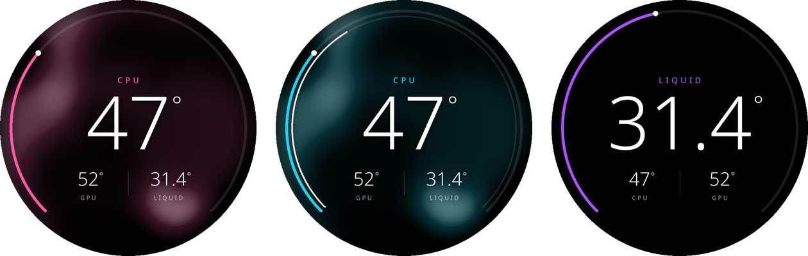
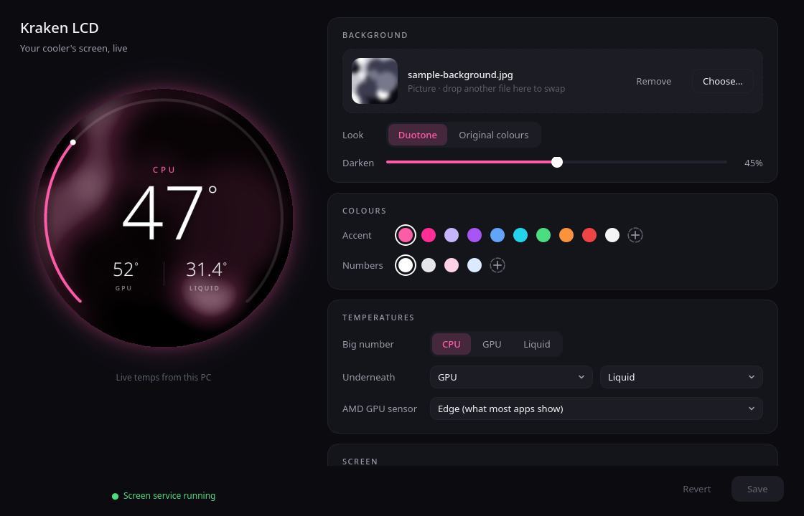

# kraken-lcd

Shows a picture or animated GIF with live CPU, GPU and liquid temperatures on the
screen of an NZXT Kraken AIO. NZXT's CAM app only does this on Windows. kraken-lcd
does the same on Linux with a small background service and a settings window.



The screen gets a thin ring that fills as the main temperature rises, one big
number, and two smaller readings under it. By default your picture is recoloured
in black, white and an accent colour you pick, so a random photo still matches
the rest of the build; you can also keep its original colours. A second, thinner
ring for the next temperature in the list is optional.

- The settings window picks the picture or GIF, the colours, which temps to show,
  rotation and brightness, and shows a round live preview. It only writes a config
  file, and closing it doesn't leave anything running.
- kraken-lcd only touches the screen. Pump and fan control stays with
  CoolerControl (see [below](#using-it-with-coolercontrol)) or the cooler's own
  curves.
- When an upload fails it retries, clears the LCD memory if that's full, and
  reconnects after suspend or a replug.



Not affiliated with NZXT.

## Supported coolers

| Cooler | USB ID | Status |
|---|---|---|
| Kraken Elite 2024 / Elite V2 | `1e71:3012` | Tested on the 420, firmware 1.2.0 |
| Kraken 2024 Plus | `1e71:3014` | Should work, untested |
| Kraken Z53 / Z63 / Z73 | `1e71:3008` | Should work, untested |
| Kraken 2023 / 2023 Elite | `1e71:300e`, `1e71:300c` | Should work, untested. Some 2023 firmware (2.x) can't show GIFs; you get the first frame with live temps instead |

Anything liquidctl's `KrakenZ3` driver can draw on is picked up automatically.
`kraken-lcd --list` shows what it finds. If yours works (or doesn't), please open an issue.

## Install

You need Python 3.11+, [liquidctl](https://github.com/liquidctl/liquidctl) 1.15+
(1.16+ for 2024 models), Pillow, and PyQt6 for the settings window.

**Arch / CachyOS / EndeavourOS / Manjaro**

```sh
sudo pacman -S --needed liquidctl python-pillow python-pyqt6 noto-fonts
git clone https://github.com/kavahn/kraken-lcd
cd kraken-lcd/packaging/arch && makepkg -si
```

**Fedora**

```sh
sudo dnf install liquidctl python3-pillow python3-pyqt6 google-noto-sans-fonts
git clone https://github.com/kavahn/kraken-lcd && cd kraken-lcd && ./install.sh
```

**Debian / Ubuntu**

```sh
sudo apt install liquidctl python3-pil python3-pyqt6 fonts-noto-core
git clone https://github.com/kavahn/kraken-lcd && cd kraken-lcd && ./install.sh
```

`install.sh` installs into `~/.local` for your user only (no root). `./install.sh uninstall` removes it.

Then start the service (it also starts at every login):

```sh
systemctl --user enable --now kraken-lcd
```

and open **Kraken LCD Settings** from your app menu.

> **Permissions:** distro liquidctl packages ship udev rules that let your user talk
> to the cooler. If `kraken-lcd --list` says permission denied, install liquidctl's
> [`71-liquidctl.rules`](https://github.com/liquidctl/liquidctl/blob/main/extra/linux/71-liquidctl.rules)
> into `/etc/udev/rules.d/` and replug the cooler or reboot.

## Using it with CoolerControl

**Turn off CoolerControl's liquidctl integration** (Settings → *Liquidctl
Integration*). CoolerControl can't hand over just the screen: with liquidctl on,
it reads from the cooler every second over the same HID connection, and two
programs doing that garble each other's replies. You'd get screen glitches and,
worse, dropped readings in CoolerControl.

With it off, CoolerControl controls the pump and fans through the kernel's
`nzxt-kraken3` driver instead (the device shows up as `kraken2024elite` or
similar). Graph and mix profiles apply there the same way. After switching:

1. Assign your pump and fan profiles to the kernel-driver device.
2. Any profile whose temperature source was the liquidctl device's **liquid**
   sensor should point at the kernel device's **Coolant temp** (`temp1`) instead.
   It's the same physical sensor.

The service logs a warning if it sees CoolerControl's liquidctl integration
switched on. For the same reason, don't run OpenKraken, your own liquidctl
scripts for the Kraken, or a second copy of kraken-lcd at the same time.

## GIFs

kraken-lcd draws the temps onto every frame, uploads the whole GIF, and lets the
cooler play it. Temperatures are re-read every *GIF temp refresh* seconds (5 by
default, down to 2 in the settings window), and the GIF is only re-sent when a
displayed number has changed.

The catch: the cooler restarts a GIF whenever it receives a new one, so the
animation jumps back when a number changes. Raising *GIF temp refresh* makes
that happen less often. Playing the GIF from the PC one frame at a time would
avoid it, but sending frames that fast crashed the Elite V2's firmware into its
bootloader in testing (a full power cut brought it back), so kraken-lcd doesn't
do that. NZXT CAM's "Infographic + GIF" mode keeps the GIF playing, which means
the firmware has another way to do this that nobody has documented yet. If you
can record CAM's USB traffic in that mode (Wireshark with USBPcap on Windows),
an issue with the capture would help a lot. Long GIFs are thinned to 48 frames,
keeping their overall speed.

## Settings

Everything lives in `~/.config/kraken-lcd/config.toml`. The settings window writes
it for you, and you can also edit it by hand. Changes reach the screen within a few seconds.

| Key | Default | |
|---|---|---|
| `image` | `""` | jpg / png / webp / animated gif. Empty = plain black |
| `style` | `"duotone"` | or `"original"` |
| `dim` | `0.45` | 0 = picture untouched, 1 = black |
| `accent_color` | `"#ff5ca8"` | ring, main label, duotone tint |
| `text_color` | `"#ffffff"` | numbers |
| `second_ring` | `false` | thinner inner ring for the second sensor in `show` |
| `second_color` | `""` | inner ring colour; empty = same as the numbers |
| `show` | `["cpu", "gpu", "liquid"]` | first gets the ring + big number |
| `gpu_sensor` | `"edge"` | AMD: `edge`, `junction` or `mem` |
| `brightness` | not set | 0–100; not set = keep the cooler's setting |
| `orientation` | not set | 0 / 90 / 180 / 270 |
| `interval` | `2.0` | seconds between temperature checks |
| `keepalive` | `30.0` | re-send a still frame at least this often |
| `gif_refresh` | `5.0` | seconds between temperature checks on GIF backgrounds |
| `gif_max_frames` | `48` | longer GIFs are thinned |
| `[ranges]` | cpu/gpu 25–95, liquid 20–45 | temperature for an empty / full ring |

Temperatures come from hwmon: `coretemp` / `k10temp` / `zenpower` for the CPU,
`amdgpu` / `nouveau` or `nvidia-smi` for the GPU, and the Kraken's kernel driver
(or liquidctl) for the liquid.

## Commands

```sh
kraken-lcd --list               # detected coolers
kraken-lcd --preview out.png    # draw a frame to a file, cooler untouched (out.gif for GIFs)
kraken-lcd --once               # draw + upload one frame
kraken-lcd --liquid             # back to the cooler's own liquid-temperature screen
journalctl --user -u kraken-lcd -f    # service log
systemctl --user stop kraken-lcd      # stop (the screen goes back to liquid temp)
```

## Troubleshooting

- **`upload hiccup` in the log.** The cooler didn't answer one step in time. The
  upload is retried, and the last good frame stays on screen meanwhile. On models
  other than the Elite V2, liquidctl's own path is used, and its `Failed to switch
  active bucket` messages mean the same thing.
- **Screen briefly shows NZXT's liquid temperature.** That happens once when the
  service starts (it clears the cooler's image memory) and when it stops. If it
  happens at other times, please open an issue with the log.
- **Screen stuck or black:** `systemctl --user restart kraken-lcd`. If that doesn't
  help, run `kraken-lcd --liquid`, then restart the service.
- **"no NZXT cooler with a screen found":** check `liquidctl list` sees it and that
  nothing else (CAM in a VM, OpenKraken, CoolerControl with liquidctl on) holds it.

## Credits

- [liquidctl](https://github.com/liquidctl/liquidctl) does all the talking to the
  cooler.
- The upload safeguards are adapted from [OpenKraken](https://github.com/davidboulay/OpenKraken)
  by David Boulay (MIT), which worked out this panel's quirks first. See `NOTICE`.

## License

MIT. See `LICENSE`.
